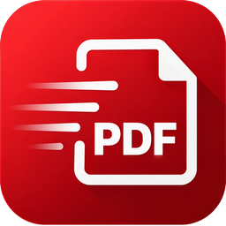

<p align="center">
  
</p>

<h1 align="center">MrPDF</h1>

<p align="center">
  <b>The free PDF editor with a familiar ribbon.</b><br>
  View, comment, fill in, sign, organise and convert PDF files – open source, no account, no cloud.
</p>

<p align="center">
  <a href="https://github.com/MrMarkus42/MrPDF/releases/latest"><b>Download for Windows</b></a> ·
  <a href="https://mrmarkus42.github.io/MrPDF/">Website</a> ·
  <a href="CHANGELOG.md">What's new</a> ·
  <a href="#deutsch">Deutsch</a>
</p>

<p align="center">
  
</p>

## Features

* **Viewing** – fast rendering with PDFium, tabs and tab groups, separate
  windows, continuous / single / two-page layouts, zoom from 5 % to 6400 %,
  rulers and grid, dark mode, full screen and presentations, read aloud
* **Comments** – highlight, underline, strike-out, notes, text boxes,
  typewriter, callouts, shapes, clouds, freehand, measurements, stamps and
  image stamps, file attachments; comment list, summary as PDF, XFDF exchange,
  flattening. Every comment has its own appearance, so it looks the same in
  every PDF viewer
* **Forms** – fill in all common field types; design forms with text,
  check box, radio, list, combo, date, image, button and signature fields;
  detect fields automatically; reset, import and export form data; fill one
  form per row of a CSV file
* **Digital signatures** – sign with your own digital ID (.pfx/.p12, or a new
  one created in MrPDF), visible or invisible, PAdES; check signatures
* **Pages** – insert, delete, extract, rotate, move, duplicate, replace, crop,
  resize, merge and split documents, several pages per sheet, watermarks,
  backgrounds, headers and footers, Bates numbering, page labels – with live
  previews
* **Edit content** – edit text and page objects, align and arrange them
* **Bookmarks** – create from headings, highlights or text files, sort, find
  and replace, table of contents
* **Review and convert** – compare documents, word count, spell check,
  accessibility report, export as images, text or Word (DOCX), create PDFs
  from images, text and office files, optimise file size
* **Security** – password protection with AES-256 and permissions, secure
  redaction, attachments, no execution of JavaScript or embedded programs
* **Comfort** – quick command search (Ctrl+.), keyboard operation of the
  ribbon (Alt), undo history, recovery after a crash, sessions, own presets
  in dialogs, updates from GitHub with checksum verification
* **German and English** user interface

<p align="center">
  
  
</p>

## Installation (Windows)

1. Download `MrPDF-<version>-windows-x64.zip` from the
   [latest release](https://github.com/MrMarkus42/MrPDF/releases/latest).
2. Unpack it into a folder of your choice, e.g. `Documents\MrPDF`.
3. Start `MrPDF.exe`. No installation and no administrator rights needed.

If the window stays black on older graphics cards, start MrPDF with
`MrPDF.exe --opengl`. New versions can be installed from
*File › Settings › Updates*.

## Building from source

Requirements: Rust 1.88 or newer.

```bash
scripts/fetch-pdfium.sh          # downloads and verifies PDFium
cargo run --release -- file.pdf
```

The PDFium library (`pdfium.dll`, `libpdfium.so` or `libpdfium.dylib`) must be
placed next to the executable for distribution.

Cross-compiling and packaging for Windows on Linux (MinGW):

```bash
rustup target add x86_64-pc-windows-gnu
scripts/package-windows.sh      # creates dist/MrPDF-<version>-windows-x64.zip
```

### Tests

```bash
cargo test                  # unit, integration and headless UI tests
python3 scripts/check-licenses.py
python3 scripts/check-release-age.py
```

The UI tests render screenshots into `target/ui-screenshots/`; the pictures of
the web site are made with `cargo test --test website -- --ignored`.

### macOS and Linux

The code is portable; build with `scripts/fetch-pdfium.sh linux-x64`,
`mac-arm64` or `mac-x64` and `cargo build --release`, then place the PDFium
library next to the binary. Printing uses CUPS (`lp`).

## Licence

MrPDF is dual-licensed under the [MIT](LICENSE-MIT) or
[Apache 2.0](LICENSE-APACHE) licence, at your option. All dependencies use
permissive licences (see [THIRD_PARTY_NOTICES.md](THIRD_PARTY_NOTICES.md));
PDFium is licensed under BSD-3-Clause / Apache-2.0. MrPDF is an independent
project and not affiliated with any commercial PDF software vendor.

See [SECURITY.md](SECURITY.md) for the security design and how to report
vulnerabilities.

---

## Deutsch

**MrPDF ist ein freier PDF-Editor mit vertrautem Menüband** – zum Ansehen,
Kommentieren, Ausfüllen, Signieren, Organisieren und Umwandeln von
PDF-Dateien. Quelloffen, ohne Konto und ohne Cloud.

**Funktionen:** Tabs und eigene Fenster, verschiedene Seitenlayouts,
Dunkelmodus, Vollbild und Vorlesen; Kommentare aller Art mit Stempeln,
Messungen und Kommentarübersicht; Formulare ausfüllen und gestalten
(inklusive Datums-, Bild-, Schaltflächen- und Signaturfeldern, automatischer
Felderkennung und Serienausfüllung aus CSV); digitale Signaturen; Seiten
einfügen, löschen, drehen, zuschneiden, zusammenfügen und aufteilen,
Wasserzeichen, Kopf- und Fußzeilen, Bates-Nummern; Texte und Objekte
bearbeiten; Lesezeichen-Werkzeuge; Dokumente vergleichen,
Rechtschreibprüfung, Barrierefreiheitsprüfung; Export als Bild, Text und
Word; Kennwortschutz mit AES-256 und sicheres Schwärzen; Schnellsuche nach
Befehlen (Strg+.), Tastaturbedienung des Menübands, Wiederherstellung nach
Abstürzen, Updates direkt aus GitHub.

**Installation:** Zip-Datei aus dem
[neuesten Release](https://github.com/MrMarkus42/MrPDF/releases/latest)
herunterladen, in einen beliebigen Ordner entpacken und `MrPDF.exe` starten –
keine Installation und keine Administratorrechte nötig.

**Webseite:** <https://mrmarkus42.github.io/MrPDF/>

**Lizenz:** MIT oder Apache-2.0 (nach Wahl). Alle verwendeten Bibliotheken
stehen unter freizügigen Lizenzen.
