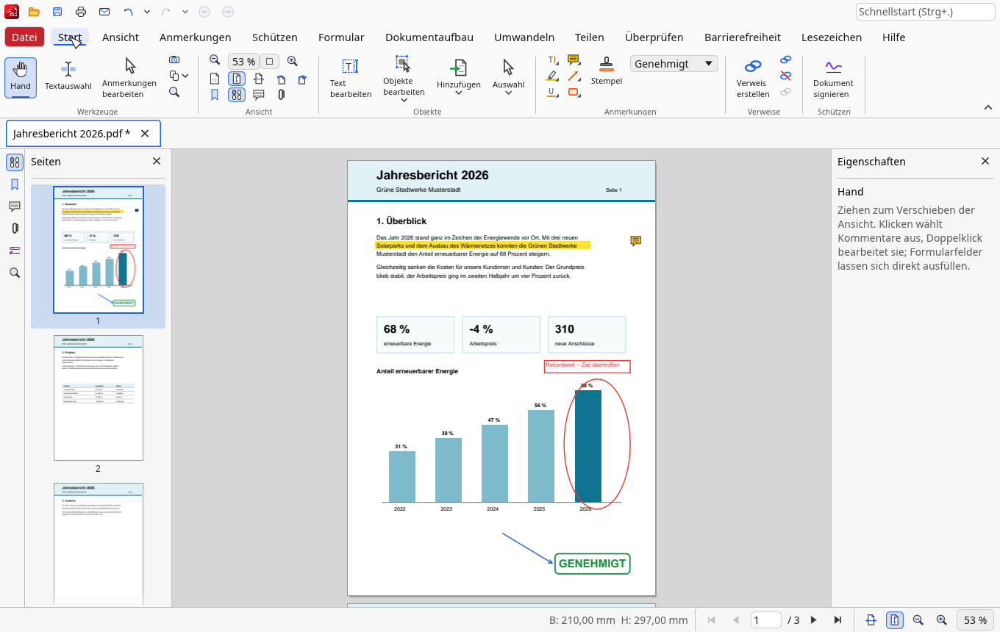
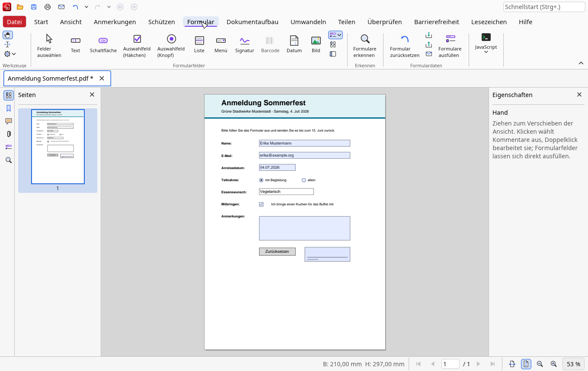
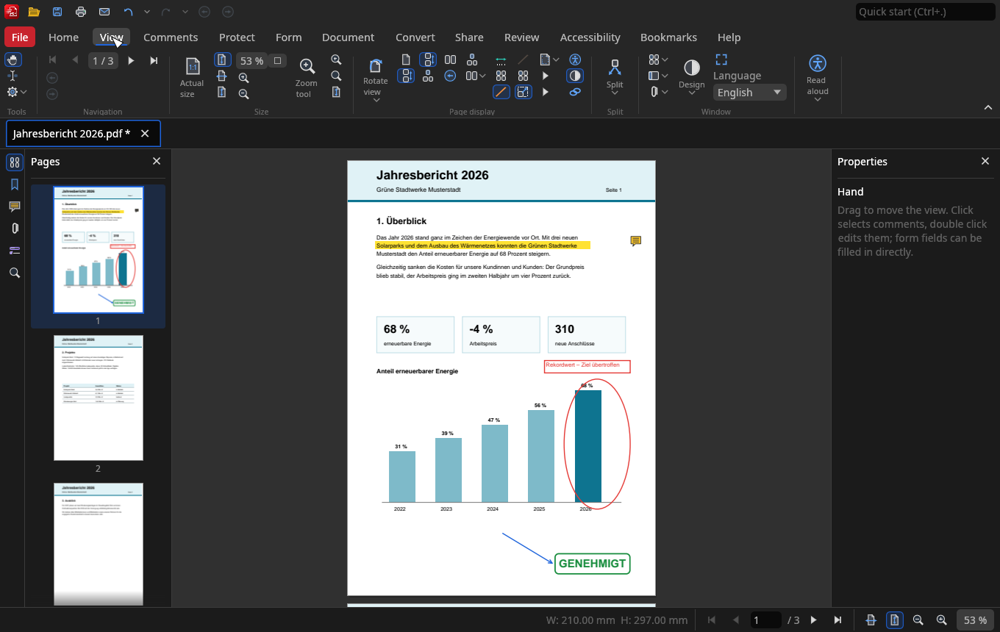

<p align="center">
  
</p>

<h1 align="center">VersoloPDF</h1>

<p align="center">
  <b>The free PDF editor with a familiar ribbon.</b><br>
  View, comment, fill in, sign, organise and convert PDF files – open source, no account, no cloud.
</p>

<p align="center">
  <a href="https://github.com/MrMarkus42/VersoloPDF/releases/latest"><b>Download for Windows and macOS</b></a> ·
  <a href="https://mrmarkus42.github.io/VersoloPDF/">Website</a> ·
  <a href="CHANGELOG.md">What's new</a> ·
  <a href="#deutsch">Deutsch</a>
</p>

<p align="center">
  
</p>

## Features

* **Viewing** – fast rendering with PDFium, tabs and tab groups, separate
  windows, continuous / single / two-page layouts, zoom from 5 % to 6400 %,
  rulers and grid, layers, dark mode, full screen and presentations, read
  aloud
* **Comments** – highlight, underline, strike-out, notes, text boxes,
  typewriter, callouts, shapes, clouds, freehand, measurements, stamps and
  image stamps, file attachments; comment list, summary as PDF, XFDF exchange,
  flattening. Every comment has its own appearance, so it looks the same in
  every PDF viewer
* **Forms** – fill in all common field types; design forms with text,
  check box, radio, list, combo, date, image, button, QR code and signature
  fields;
  detect fields automatically; reset, import and export form data; fill one
  form per row of a CSV file
* **Digital signatures** – sign with your own digital ID (.pfx/.p12, a new
  one created in VersoloPDF, or on the Mac from the keychain), visible or
  invisible, PAdES; certify documents;
  time stamps from a time stamp authority (RFC 3161); check signatures
* **Pages** – insert, delete, extract, rotate, move, duplicate, replace, crop,
  resize, merge and split documents, several pages per sheet, watermarks,
  backgrounds, headers and footers, Bates numbering, page labels – with live
  previews
* **Edit content** – edit text and page objects, align and arrange them
* **Bookmarks** – create from headings, highlights or text files, sort, find
  and replace, table of contents
* **Review and convert** – compare documents, word count, spell check,
  accessibility report, export as images, text or Word (DOCX), create PDFs
  from images, text and office files, optimise file size
* **Security** – protected mode: every document is read by its own
  sandboxed helper process without access to your files, the network or
  other programs; password protection with AES-256 and permissions, secure
  redaction, attachments, no execution of JavaScript or embedded programs
* **Comfort** – quick command search (Ctrl+.), keyboard operation of the
  ribbon (Alt), undo history, recovery after a crash, sessions, own presets
  in dialogs, signed updates from GitHub
* **German and English** user interface

<p align="center">
  
  
</p>

## Installation (Windows)

1. Download `VersoloPDF-<version>-windows-x64.zip` from the
   [latest release](https://github.com/MrMarkus42/VersoloPDF/releases/latest).
2. Unpack it into a folder of your choice, e.g. `Documents\VersoloPDF`.
3. Start `VersoloPDF.exe`. No installation and no administrator rights needed.

If the window stays black on older graphics cards, start VersoloPDF with
`VersoloPDF.exe --opengl`. New versions can be installed from
*File › Settings › Updates*.

## Installation (macOS)

1. Download `VersoloPDF-<version>-macos.zip` from the
   [latest release](https://github.com/MrMarkus42/VersoloPDF/releases/latest)
   (one app for Apple chips and Intel, macOS 11 or newer).
2. Open the zip file and drag `VersoloPDF.app` into *Programme* /
   *Applications*.
3. The first start: VersoloPDF is not notarised by Apple (that needs a paid
   Apple developer account), so macOS refuses to open it at first. Open
   *System Settings › Privacy & Security*, scroll down and click
   *Open Anyway* next to VersoloPDF. This is needed only once.

On the Mac, VersoloPDF has the usual menu bar with its commands, prints
through the macOS print dialog, recognises text
with the text recognition built into macOS, signs with digital IDs from the
keychain, attaches files to a new message in Apple Mail or Outlook and opens
PDFs from the Finder. New versions install themselves from
*File › Settings › Updates*.

## Building from source

Requirements: Rust 1.88 or newer.

```bash
scripts/fetch-pdfium.sh          # downloads and verifies PDFium
cargo run --release -- file.pdf
```

The PDFium library (`pdfium.dll`, `libpdfium.so` or `libpdfium.dylib`) must be
placed next to the executable for distribution.

Cross-compiling and packaging for Windows on Linux (MinGW):

```bash
rustup target add x86_64-pc-windows-gnu
scripts/package-windows.sh      # creates dist/VersoloPDF-<version>-windows-x64.zip
```

The macOS app is built on a Mac (GitHub Actions: `.github/workflows/macos.yml`):

```bash
rustup target add aarch64-apple-darwin x86_64-apple-darwin
scripts/package-macos.sh        # creates dist/VersoloPDF-<version>-macos.zip
```

### Tests

```bash
cargo test                  # unit, integration and headless UI tests
python3 scripts/check-licenses.py
python3 scripts/check-release-age.py
```

The UI tests render screenshots into `target/ui-screenshots/`; the pictures of
the web site are made with `cargo test --test website -- --ignored`.

### macOS and Linux

The code is portable; build with `scripts/fetch-pdfium.sh linux-x64`,
`mac-arm64` or `mac-x64` and `cargo build --release`, then place the PDFium
library next to the binary. Printing uses CUPS (`lp`).

## Licence

VersoloPDF is dual-licensed under the [MIT](LICENSE-MIT) or
[Apache 2.0](LICENSE-APACHE) licence, at your option. All dependencies use
permissive licences (see [THIRD_PARTY_NOTICES.md](THIRD_PARTY_NOTICES.md));
PDFium is licensed under BSD-3-Clause / Apache-2.0. VersoloPDF is an independent
project and not affiliated with any commercial PDF software vendor.

See [SECURITY.md](SECURITY.md) for the security design and how to report
vulnerabilities.

---

## Deutsch

**VersoloPDF ist ein freier PDF-Editor mit vertrautem Menüband** – zum Ansehen,
Kommentieren, Ausfüllen, Signieren, Organisieren und Umwandeln von
PDF-Dateien. Quelloffen, ohne Konto und ohne Cloud.

**Funktionen:** Tabs und eigene Fenster, verschiedene Seitenlayouts,
Dunkelmodus, Vollbild und Vorlesen; Kommentare aller Art mit Stempeln,
Messungen und Kommentarübersicht; Formulare ausfüllen und gestalten
(inklusive Datums-, Bild-, Schaltflächen-, QR-Code- und Signaturfeldern,
automatischer Felderkennung und Serienausfüllung aus CSV); digitale Signaturen,
Zertifizieren und Zeitstempel; Ebenen; Seiten
einfügen, löschen, drehen, zuschneiden, zusammenfügen und aufteilen,
Wasserzeichen, Kopf- und Fußzeilen, Bates-Nummern; Texte und Objekte
bearbeiten; Lesezeichen-Werkzeuge; Dokumente vergleichen,
Rechtschreibprüfung, Barrierefreiheitsprüfung; Export als Bild, Text und
Word; Kennwortschutz mit AES-256 und sicheres Schwärzen; geschützter Modus
(jedes Dokument wird in einem abgeschirmten Hilfsprogramm ohne Zugriff auf
Ihre Dateien, das Netz und andere Programme gelesen); Schnellsuche nach
Befehlen (Strg+.), Tastaturbedienung des Menübands, Wiederherstellung nach
Abstürzen, signierte Updates direkt aus GitHub.

**Installation unter Windows:** Zip-Datei `…-windows-x64.zip` aus dem
[neuesten Release](https://github.com/MrMarkus42/VersoloPDF/releases/latest)
herunterladen, in einen beliebigen Ordner entpacken und `VersoloPDF.exe` starten –
keine Installation und keine Administratorrechte nötig.

**Installation auf dem Mac:** `…-macos.zip` herunterladen, öffnen und
`VersoloPDF.app` in den Ordner *Programme* ziehen (macOS 11 oder neuer, Apple-
und Intel-Chips). Beim ersten Start lehnt macOS das Öffnen ab, weil VersoloPDF
nicht von Apple beglaubigt ist: dann unter *Systemeinstellungen › Datenschutz &
Sicherheit* ganz unten bei VersoloPDF auf *Dennoch öffnen* klicken – das ist nur
einmal nötig. Auf dem Mac druckt VersoloPDF über den Druckdialog von macOS,
erkennt Text mit der Texterkennung von macOS, signiert mit digitalen IDs aus
dem Schlüsselbund und hängt Dateien an eine neue Nachricht in Apple Mail oder
Outlook an.

**Webseite:** <https://mrmarkus42.github.io/VersoloPDF/>

**Lizenz:** MIT oder Apache-2.0 (nach Wahl). Alle verwendeten Bibliotheken
stehen unter freizügigen Lizenzen.
